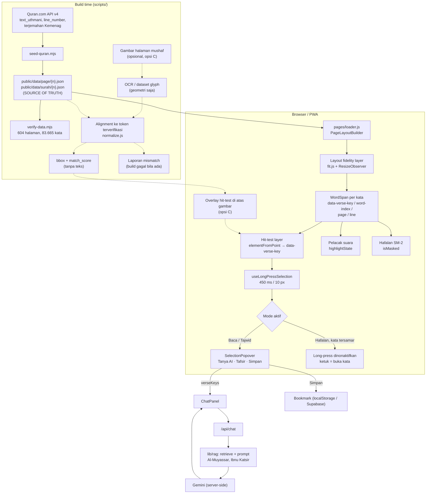

# Spesifikasi Fitur: Visualisasi Halaman Mushaf Interaktif (Per Page Update)

**Produk:** Tarseekh (ترسيخ)
**Branch:** `per-page-update`
**Tanggal:** 31 Oktober 2026
**Sub-tema lomba:** Inovasi Pembelajaran Masa Depan (Future Education & AI)
**Status:** Draft untuk ditinjau tim

> Semua klaim tentang kode di dokumen ini merujuk ke kondisi `upstream/main` (commit `f83d763`). Angka pengukuran berasal dari pengujian yang dijalankan pada 31 Oktober 2026 (metode di §7).

---

## (a) Ringkasan Eksekutif

Permintaan awal adalah lapisan **OCR** di atas gambar halaman mushaf agar setiap kata dapat dikenali dan disentuh, terinspirasi tampilan halaman Tarteel. Setelah memeriksa repo, ditemukan fakta yang mengubah arah desain:

**Halaman mushaf di Tarseekh bukan gambar statis.** `MushafPageView.jsx` sudah merender 604 halaman sebagai **teks terverifikasi**: setiap kata adalah elemen `WordSpan` dengan atribut `data-verse-key`, `data-word-index`, `data-page`, dan `data-line`, yang berasal dari data Quran.com API v4 (`public/data/page/{n}.json`, field `line_number` per kata). Artinya hit-testing per kata, pemetaan kata→ayat, dan sinkronisasi metadata **sudah ada dan bernilai 100% benar secara konstruksi**. Menambahkan OCR justru akan menurunkan sumber kebenaran dari data terverifikasi menjadi hasil pengenalan visual yang probabilistik.

Karena itu spesifikasi ini merekomendasikan **arsitektur "OCR-free by default"**: lapisan visualisasi dibangun dari data terverifikasi yang sudah ada, dan OCR hanya ditempatkan sebagai jalur opsional (validasi atau dukungan gambar halaman di masa depan) yang tidak pernah menjadi teks kanonik.

Pemeriksaan repo justru menemukan **dua masalah deterministik yang nyata dan terukur** pada tampilan per halaman:

| # | Masalah | Kondisi saat ini (terukur) | Target |
|---|---|---|---|
| P1 | **Integritas 15 baris mushaf rusak**: hampir semua baris mushaf terpecah menjadi 2 baris visual | **97,9%** baris terpecah di lebar 390 px; **99,0%** di 1280 px (sampel 13 halaman, 192 baris) | 0% baris terpecah di 360/390/768/1280 px |
| P2 | **Tap-and-hold di HP tidak memunculkan popover kustom** (Tanya AI / Tafsir / Simpan) | Popover muncul **0%** pada seleksi gaya long-press (emulasi HP) di `upstream/main` | 100% pada uji otomatis, dan lolos uji manual Android Chrome + iOS Safari |
| P3 | **Risiko regresi** pada mode yang sudah ada saat lapisan baru ditambahkan | 62/62 unit test lulus (11 file) | Tetap 62/62 + test baru untuk logika lapisan |

Kaitannya dengan tema lomba: semua fitur AI dan gamifikasi Tarseekh (Tanya AI berbasis RAG, pelacak suara, hafalan SM-2) bergantung pada **interaksi tingkat kata yang andal di tampilan mushaf**. Tampilan mushaf yang tidak lagi berbentuk 15 baris dan popover yang tidak muncul di HP adalah hambatan langsung bagi metode belajar interaktif tersebut.

---

## (b) Spesifikasi Fitur

### 1. Konsep Inti: Visualisasi Halaman Berbasis Teks Terverifikasi

#### 1.1 Kondisi yang sudah ada (hasil inspeksi)

| Kebutuhan dari brief | Status di repo | Bukti |
|---|---|---|
| Teks Arab per halaman dengan posisi kata | ✅ Sudah ada | `public/data/page/{1..604}.json` → `lines[].words[]` berisi `verse_key`, `idx`, `text`, `type` (`word`/`end`) |
| Tata letak asli: baris, penanda ayat, urutan RTL | ✅ Data ada, ❌ rendering rusak (P1) | `line_number` dari Quran.com API (`scripts/seed-quran.mjs` baris 97, `word_fields=...line_number`), tipe baris `surah_header` / `bismillah` / `text` |
| Kata/ayat dapat diidentifikasi & diinteraksikan | ✅ Sudah ada | `WordSpan.jsx` memasang `data-verse-key`, `data-word-index`, `data-page`, `data-line`; `onClick` per kata |
| Sinkron dengan metadata surah/ayat/juz | ✅ Sudah ada | `public/data/index.json` (`verse_to_page`, `juz_to_page`), `src/lib/quran/position.js` |
| Harakat & simbol Qur'ani utuh | ✅ Sudah ada | Teks `text_uthmani` dirender langsung dengan font Amiri Quran (`.font-quran`) |
| Hit-testing per kata | ✅ Sudah ada | Elemen DOM per kata; tidak perlu koordinat hasil OCR |

**Kesimpulan:** "halaman yang bukan lagi satu gambar statis" sudah terwujud. Yang belum terwujud adalah **kesetiaan visual pada tata letak 15 baris** (P1) dan **interaksi long-press yang andal di HP** (P2).

#### 1.2 Konsep yang diusulkan

Lapisan visualisasi per halaman terdiri dari tiga bagian:

1. **Layout fidelity layer.** Menjamin setiap baris data (`line`) dirender tepat sebagai satu baris visual, rata kanan-kiri, tanpa mengubah teks. Mekanisme utama: *fit-to-width* per halaman (ukuran font dihitung agar baris terpanjang muat), bukan `transform: scaleX` yang merusak bentuk huruf.
2. **Interaction layer.** Gestur long-press kustom pada `WordSpan` yang memilih kata/ayat berdasarkan atribut data, lalu membuka `SelectionPopover` (Tanya AI, Tafsir, Simpan) tanpa bergantung pada seleksi teks bawaan ponsel.
3. **Optional visual-recognition layer (OCR).** Hanya untuk (a) validasi otomatis bahwa tampilan halaman cocok dengan mushaf cetak, atau (b) dukungan gambar halaman asli di masa depan. Tidak pernah dirender sebagai teks.

#### 1.3 Batasan keras: sumber kebenaran

**Data terverifikasi (Quran.com API v4 + terjemahan Kemenag RI, di-seed ke `public/data/`) adalah satu-satunya sumber teks Al-Qur'an.** Arsitektur menegakkannya dengan cara berikut:

| Aturan | Penegakan |
|---|---|
| Teks yang dirender selalu berasal dari `page/{n}.json` / `surah/{n}.json` | `WordSpan` hanya menerima prop `text` dari loader (`src/lib/pages/loader.js`, `src/lib/quran/loader.js`); tidak ada jalur yang memberi teks dari OCR ke komponen render |
| Keluaran OCR (jika dipakai) hanya berupa **geometri + skor kecocokan**, bukan teks | Skema keluaran OCR: `{ page, line, verse_key, idx, bbox, match_score }`. Field `text` hasil OCR hanya disimpan di artefak evaluasi, tidak di `public/data/` |
| Setiap token OCR wajib di-*align* ke urutan token terverifikasi | Alignment berurutan (urutan baca RTL) memakai normalisasi `src/lib/arabic/normalize.js` yang sudah dipakai pelacak suara; token tanpa pasangan ditandai `unmatched` |
| Ketidakcocokan dilaporkan, tidak diperbaiki diam-diam | Skrip `scripts/verify-*.mjs` gagal (exit code ≠ 0) bila ada `unmatched` atau `match_score` di bawah ambang |
| Integritas data dijaga oleh pemeriksaan yang sudah ada | `npm run verify:data` sudah memeriksa 604 halaman, 114 surah, dan sinkronisasi 83.665 kata antara data halaman dan data surah |

### 2. Fitur yang Wajib Tetap Berfungsi

Mode di kode (`ReaderTopBar.jsx`): **Baca** (`read`), **Tajwid** (`tajwid`), **Hafalan** (`memorize`). Istilah di brief dipetakan sebagai berikut.

#### A. Highlight Mode → seleksi + `SelectionPopover` + highlight pelacak suara

- **Kondisi sekarang:** `SelectionPopover.jsx` membaca seleksi teks bawaan (`window.getSelection()`), mengambil `data-verse-key` dari kata dalam rentang seleksi, lalu memunculkan popover. Batas 7 ayat sudah ada (`isTooMany`). Highlight pelacak suara memakai `highlightState` (`current` / `matched` / `missed`) di `WordSpan`.
- **Integrasi:** gestur long-press baru menghasilkan objek seleksi yang sama (`{ verseKeys, selectedText, rect }`) dan memanggil popover yang sama. Callback `onAskAI`, `onQuickTafsir`, dan `onBookmark` di `MushafPageView` dan `VerseListView` tidak berubah, sehingga alur RAG (`/api/chat`, chip sumber, penolakan fatwa) tidak tersentuh.
- **Tanpa regresi:** di desktop (pointer `mouse`), seleksi seret bawaan tetap berjalan seperti sekarang.

#### B. Read Mode (Baca)

- Tidak ada perubahan perilaku. Ketukan biasa pada kata tetap memanggil `handleWordManualClick` (maju manual saat mic aktif).
- **Aturan baru:** bila long-press terjadi, event `click` sesudahnya ditekan (*suppressed*) agar tidak dihitung sebagai "maju manual" pada pelacak suara.
- Fit-to-width hanya mengubah `font-size` kontainer halaman, tidak mengubah teks atau urutan kata.

#### C. Hide Mode → Hafalan (penyamaran kata)

- **Kondisi sekarang:** kata tersamar dirender oleh cabang `isMasked` di `WordSpan` (kelas `select-none`, `minWidth` berbasis panjang teks); ketukan membuka kata (`revealedWords`).
- **Aturan baru:** long-press **dinonaktifkan pada kata tersamar**, agar popover tidak menjadi jalan pintas untuk membuka kata yang sedang dihafal. Ketukan untuk membuka kata tetap seperti sekarang.
- Fit-to-width menghitung lebar memakai teks asli, sehingga lebar kata tersamar tetap sama dan tidak ada *layout shift* saat kata terbuka (sesuai kriteria FR-5 PRD).

#### D. Mode lain yang juga dijaga

- **Tajwid:** pewarnaan per token (`tajweedTokens`) tetap di dalam `WordSpan`; long-press tidak boleh memicu `activeRulePopover` (sheet penjelasan hukum tajwid).
- **Posisi sinkron:** `position.js` dan perpindahan tampilan ayat ↔ halaman tidak berubah.

### 3. Interaksi & Seleksi di HP

#### 3.1 Akar masalah (P2)

`SelectionPopover` di `upstream/main` hanya memeriksa seleksi pada event `pointerup` dan `touchend`. Di HP, seleksi akibat long-press berakhir dengan `pointercancel` / `touchcancel`, dan menggeser *handle* seleksi tidak memicu event sentuh pada halaman. Akibatnya popover kustom tidak pernah muncul dan yang tampil hanya menu seleksi bawaan ponsel.

Perbaikan minimal sudah dibuat di branch `fix/phone-highlight` (mendengarkan `selectionchange` dengan debounce 300 ms). Perbaikan itu **masih memakai seleksi bawaan**, sehingga menu bawaan ponsel tetap muncul berdampingan dengan popover kustom. Brief meminta seleksi bawaan ditekan, jadi spesifikasi di bawah menggantinya dengan gestur kustom pada perangkat sentuh.

#### 3.2 Mekanisme yang diusulkan

| Mekanisme | Penerapan | Alasan |
|---|---|---|
| `user-select: none` + `-webkit-user-select: none` | Hanya pada kontainer teks mushaf/ayat **untuk `@media (pointer: coarse)`** | Mencegah seleksi bawaan di HP; desktop tetap bisa menyeleksi dan menyalin |
| `-webkit-touch-callout: none` | Sama seperti di atas | Menekan *callout* bawaan iOS Safari saat long-press |
| `contextmenu` → `preventDefault()` | Listener pada kontainer teks, hanya untuk pointer `touch` | Menekan menu konteks long-press di Android Chrome |
| `touch-action: pan-y` | Sudah ada di root `MushafPageView` | Scroll vertikal dan geser halaman tetap berjalan |
| Pointer Events untuk long-press | `pointerdown` memulai timer **450 ms**; batal bila bergerak > **10 px** atau `pointerup`/`pointercancel` sebelum waktunya | Membedakan ketuk, scroll, geser halaman, dan tahan |
| Hit-testing | `document.elementFromPoint(x, y)` → elemen terdekat dengan `data-verse-key` | Memakai atribut yang sudah ada; tanpa OCR, tanpa koordinat tambahan |
| Unit seleksi | Long-press memilih **satu ayat penuh** (semua `WordSpan` dengan `verse_key` yang sama); geser setelahnya memperluas seleksi per ayat hingga 7 ayat | Konsisten dengan batas 7 ayat di popover dan unit yang dipakai RAG |
| Highlight seleksi | State `selectedVerseKeys` → prop baru `isSelected` di `WordSpan` (kelas latar yang sudah ada, misalnya `bg-emerald-500/10`) | Highlight tidak bergantung pada `::selection` bawaan |
| `click` sesudah long-press | Ditekan satu kali | Mencegah maju manual atau buka kata tidak sengaja |
| `selectionchange` (dari `fix/phone-highlight`) | Tetap dipertahankan sebagai fallback | Bila suatu browser tetap membuat seleksi bawaan, popover tetap muncul |

**Konsekuensi yang harus disetujui tim:** di HP, pengguna kehilangan fitur "Salin" bawaan pada teks Al-Qur'an. Bila dibutuhkan, aksi "Salin" dapat ditambahkan ke popover, tetapi brief hanya meminta tiga aksi sehingga ini dicatat sebagai keputusan terbuka.

`SelectionPopover` diubah menjadi dapat dipakai dalam dua mode: **uncontrolled** (seperti sekarang, membaca seleksi bawaan; untuk desktop) dan **controlled** (menerima prop `selection` dari gestur long-press; untuk perangkat sentuh).

### 4. Pertimbangan Teknis

#### 4.1 Evaluasi arsitektur

| Opsi | Sumber teks | Hit-testing | Kesetiaan visual mushaf | Offline | Rekomendasi |
|---|---|---|---|---|---|
| **A. Teks terverifikasi + fit-to-width** (sekarang + perbaikan) | Data terverifikasi | DOM `WordSpan` (sudah ada) | Mirip mushaf; tiap baris = satu baris visual; bentuk huruf Amiri Quran, bukan khat mushaf Madinah | ✅ Sudah tercakup service worker | **Utama (fase ini)** |
| **B. Font glyph mushaf per halaman** (QPC/QCF) | Data terverifikasi + kode glyph per kata dari Quran.com API v4 | DOM per kata (sama dengan A) | Sangat dekat dengan mushaf Madinah cetak | Perlu menyimpan 604 berkas font | **Eksplorasi P2**: wajib cek lisensi, ukuran berkas, dan field API sebelum dipakai |
| **C. Gambar halaman + bbox hasil alignment/OCR** | Data terverifikasi (OCR hanya geometri) | Overlay absolut di atas gambar | Identik dengan gambar sumber | Perlu menyimpan 604 gambar + bbox | Tidak direkomendasikan sekarang; kompleksitas dan biaya tinggi, manfaat tambahan kecil dibanding B |

#### 4.2 Butir teknis yang diminta brief

- **Pengenalan huruf Arab & bentuk kontekstual:** pada opsi A/B, *shaping* dilakukan oleh mesin teks browser (HarfBuzz/CoreText) dari Unicode terverifikasi, sehingga tidak ada pengenalan yang bisa salah. Pada opsi C, akurasi OCR terhadap teks bervokal penuh **belum diukur untuk repo ini** dan harus diukur pada fase 1 sebelum dipakai.
- **Akurasi harakat & simbol:** opsi A/B mewarisi akurasi data sumber (100% terhadap Quran.com API). Untuk opsi C, harakat hanya dipakai untuk mencocokkan, bukan untuk ditampilkan.
- **Bounding box per kata:** opsi A/B memakai `getBoundingClientRect()` dari DOM saat runtime. Opsi C membutuhkan bbox hasil OCR atau dataset koordinat glyph yang sudah dipetakan ke halaman.
- **Kebenaran RTL:** `.font-quran` memakai `direction: rtl`; urutan kata dalam `line.words` sudah sesuai urutan baca. Fit-to-width tidak mengubah urutan.
- **Pemetaan ke metadata ayat:** sudah 1:1 lewat `verse_key` + `idx` per token.
- **Performa & cache 604 halaman:**
  - Data halaman saat ini berukuran **13 MB** (604 berkas) dan data surah **19 MB**; keduanya dimuat per halaman/surah, dan service worker (`public/sw.js`) mem-precache halaman 1–2 lalu menyimpan sisanya saat diakses.
  - Fit-to-width dihitung di klien per halaman: satu kali pengukuran baris terpanjang per perubahan lebar kontainer (`ResizeObserver`). Hasilnya di-cache per `{page, containerWidth, font_scale}` di memori.
  - Bila OCR/alignment dipakai (opsi C), prosesnya **dihitung di awal saat build** lewat skrip baru di `scripts/`, sejalan dengan pola `seed-quran.mjs` dan `embed-tafsir.mjs`, bukan di perangkat.
- **Tata letak responsif:** ukuran font dihitung dari lebar kontainer, sehingga satu halaman tetap 15 baris pada 360 px sampai layar desktop. Pengaturan `font_scale` pengguna menjadi batas atas, bukan nilai tetap, pada tampilan halaman.

#### 4.3 Kandidat mesin OCR (hanya relevan bila opsi C dipilih)

| Kandidat | Akurasi pada teks Qur'ani bervokal | Latensi | Offline | Biaya | Catatan |
|---|---|---|---|---|---|
| Tesseract (`ara` traineddata) | Belum diukur; perlu benchmark | Lokal, saat build | ✅ | Gratis | Paling mudah dicoba di skrip build |
| Layanan OCR cloud dengan dukungan Arab | Belum diukur; perlu benchmark | Panggilan jaringan, saat build | ❌ saat proses, ✅ hasil bisa di-cache | Berbayar per halaman | Hanya untuk 604 halaman sekali proses; kunci API hanya di server/CI |
| Dataset koordinat glyph mushaf yang sudah ada | Tidak perlu OCR | Tidak ada (data siap pakai) | ✅ | Tergantung lisensi | Bila tersedia dengan lisensi yang sesuai, ini lebih andal daripada OCR |

Semua kandidat harus melewati metrik fase 1 (§5) sebelum dipakai, dan tidak ada yang boleh menghasilkan teks yang dirender.

### 5. Prioritas Implementasi

Urutan mengikuti brief. Fase 1–2 sebagian besar sudah terpenuhi oleh arsitektur yang ada, sehingga keluarannya berupa keputusan dan uji, bukan kode baru.

| # | Langkah | Keluaran | Kriteria penerimaan & metrik |
|---|---|---|---|
| 1 | Investigasi kelayakan OCR Arab Qur'ani tingkat kata | Catatan keputusan (ADR) di `docs/` | Keputusan A/B/C terdokumentasi. Bila C dievaluasi: *word detection recall* ≥ 99% dan *alignment match* 100% pada sampel ≥ 20 halaman, diukur terhadap token terverifikasi |
| 2 | Pemetaan kata → teks terverifikasi + metadata | Uji otomatis | `npm run verify:data` lulus (604 halaman, 83.665 kata sinkron). Tambah test: setiap token `page/{n}.json` memiliki pasangan di `surah/{s}.json` dengan `verse_key` + `idx` sama |
| 3 | Lapisan visualisasi interaktif (fit-to-width) | Perubahan `MushafPageView.jsx` + util murni di `src/lib/pages/` | **Line integrity = 100%** pada lebar 360/390/768/1280 px (metode §7). Tidak ada scroll horizontal (`scrollWidth == clientWidth`). Ukuran font ≥ batas keterbacaan yang disepakati tim |
| 4 | Integrasi dengan mode Baca, Tajwid, Hafalan | Prop `isSelected` di `WordSpan`, aturan long-press per mode | 62/62 test lama tetap lulus. Test baru: long-press nonaktif pada kata tersamar, `click` ditekan setelah long-press, pewarnaan tajwid tidak berubah |
| 5 | Perbaikan tap-hold HP + popover kustom | Hook gestur long-press, `SelectionPopover` mode controlled | **Popover success rate = 100%** dan **mis-selection = 0%** pada ≥ 50 kata acak (uji otomatis emulasi HP). Uji manual: tidak ada menu bawaan pada Android Chrome dan iOS Safari |
| 6 | Uji akurasi, performa, kompatibilitas | Laporan uji di `docs/` | Halaman tampil < 500 ms setelah prefetch (kriteria PRD FR-1b). Tidak ada *layout shift* saat font menyesuaikan. Lulus di Chrome Android, Safari iOS, Chrome dan Firefox desktop |

### 6. Batasan Pengembangan

#### 6.1 Komponen yang dipakai ulang tanpa diubah

| Berkas | Peran |
|---|---|
| `src/lib/pages/loader.js`, `src/lib/pages/layout.js` | Memuat data halaman dan `PageLayoutBuilder.allWords()` |
| `src/lib/quran/loader.js`, `src/lib/quran/position.js` | Data surah, indeks ayat↔halaman, posisi terakhir |
| `src/lib/arabic/normalize.js` | Normalisasi untuk alignment (bila opsi C dipakai) |
| `src/lib/tajwid/*`, `src/lib/memorization/engine.js`, `src/lib/speech/*` | Tajwid, penyamaran hafalan, pelacak suara |
| `src/components/chat/ChatPanel.jsx`, `src/app/api/chat/route.js`, `src/lib/rag/*` | Alur Tanya AI / Tafsir berbasis RAG |
| `scripts/verify-data.mjs` | Pemeriksa integritas data |

#### 6.2 Komponen yang dimodifikasi

| Berkas | Perubahan | Kompatibilitas |
|---|---|---|
| `MushafPageView.jsx` | Fit-to-width per halaman (ResizeObserver), state `selectedVerseKeys`, sambungan ke hook long-press | Mode, mic, hafalan, navigasi halaman tidak berubah |
| `WordSpan.jsx` | Prop opsional `isSelected`, handler pointer untuk long-press | Default `isSelected=false`; tanpa prop baru perilakunya sama persis |
| `SelectionPopover.jsx` | Mode controlled (prop `selection`) + fallback `selectionchange` | Tanpa prop `selection`, perilaku desktop tetap seperti sekarang |
| `VerseListView.jsx` | Memakai hook long-press yang sama (fase 5) | Callback popover tidak berubah |

#### 6.3 Komponen baru

| Berkas | Isi |
|---|---|
| `src/lib/pages/fit.js` (+ test) | Fungsi murni: hitung ukuran font dari lebar kontainer dan lebar natural baris terpanjang |
| `src/lib/interaction/longPress.js` (+ test) | Mesin status gestur murni (idle → pressing → selected / cancelled) dengan ambang 450 ms / 10 px, dapat diuji tanpa DOM |
| `src/components/reader/useLongPressSelection.js` | Hook yang menghubungkan mesin status ke DOM (`elementFromPoint`, `data-verse-key`) |

Implementasi dilakukan per fase dengan satu commit per langkah agar mudah ditinjau dan dibatalkan.

### 7. Masalah Deterministik

Kriteria "deterministik": kondisi gagal dapat direproduksi dengan langkah yang sama, diukur oleh skrip (bukan penilaian subjektif), dan memiliki angka sebelum/sesudah.

#### P1. Integritas 15 baris mushaf (dipilih)

- **Pernyataan:** data setiap halaman berisi baris yang tepat sesuai mushaf Madinah (field `line_number` per kata), tetapi `MushafPageView` merender tiap baris dengan font berukuran tetap (`--quran-scale`, bawaan 1,75 rem) tanpa penyesuaian lebar. State `isFlowingFallback` dideklarasikan tetapi tidak pernah bernilai `true`. Akibatnya baris yang panjang terpecah menjadi dua baris visual, dan halaman tidak lagi tampil sebagai 15 baris.
- **Fitur yang mengatasi:** layout fidelity layer (fit-to-width), §1.2 butir 1.
- **Metrik:** *line integrity* = persentase baris data (`data-line`) yang semua kata bertipe `word`-nya berada pada satu baris visual.
- **Metode evaluasi:** Chrome headless lewat DevTools Protocol, emulasi lebar 390 px (mobile) dan 1280 px (desktop). Untuk setiap baris, titik tengah vertikal setiap `WordSpan[data-type="word"]` dikelompokkan; baris visual baru dihitung bila selisihnya > 0,9× ukuran font. Pengukuran dilakukan setelah `document.fonts.ready`.
- **Hasil sebelum (31 Okt 2026, 13 halaman: 3, 50, 100, …, 600; 192 baris):**
  - 390 px: **188/192 baris terpecah (97,9%)**, line integrity 2,1%
  - 1280 px: **190/192 baris terpecah (99,0%)**, line integrity 1,0%
- **Target sesudah:** line integrity **100%** di 360, 390, 768, dan 1280 px, untuk seluruh 604 halaman.
- **Mengapa deterministik:** data baris bersifat tetap, font dan lebar viewport ditentukan, dan hitungan dilakukan oleh skrip. Hasil yang sama akan muncul setiap kali dijalankan.

#### P2. Tap-and-hold di HP tidak membuka popover kustom (dipilih)

- **Pernyataan:** di HP, menahan ayat hanya memunculkan seleksi bawaan; popover Tanya AI / Tafsir / Simpan tidak muncul (akar masalah di §3.1).
- **Fitur yang mengatasi:** gestur long-press kustom + popover mode controlled (§3.2).
- **Metrik:**
  - *Popover success rate* = persentase percobaan long-press yang membuka popover kustom.
  - *Mis-selection rate* = persentase percobaan di mana `verseKeys` popover ≠ `data-verse-key` dari kata yang ditekan.
- **Metode evaluasi:** emulasi HP (DevTools Protocol, `mobile: true`, touch emulation) pada ≥ 50 kata acak dari halaman acak; ditambah uji manual di Android Chrome dan iOS Safari untuk memastikan menu bawaan tidak muncul (hal ini tidak dapat diotomatisasi di headless).
- **Hasil sebelum:** seleksi gaya long-press (seleksi terbentuk tanpa `pointerup`/`touchend`) pada QS 1:2 menghasilkan **popover 0%** di `upstream/main`. Dengan perbaikan di `fix/phone-highlight`, hasilnya **100%** pada uji yang sama, tetapi menu bawaan masih muncul.
- **Target sesudah:** success rate 100%, mis-selection 0%, dan menu bawaan tidak muncul pada kedua perangkat uji.
- **Mengapa deterministik:** gestur disimulasikan dengan urutan event yang sama setiap kali, dan hasilnya diperiksa dengan membaca DOM (ada/tidaknya tombol "Tanya AI" serta isi `verseKeys`).

#### P3. Risiko regresi (dipilih sebagai pagar pengaman)

- **Pernyataan:** perubahan pada `WordSpan`, `MushafPageView`, dan `SelectionPopover` menyentuh komponen yang dipakai semua mode.
- **Metrik:** jumlah unit test yang lulus.
- **Kondisi sebelum:** **62/62 test lulus** di 11 berkas (README masih menyebut 38; angka itu sudah usang).
- **Suite yang wajib tetap hijau:** `quran/loader.test.js` (4), `quran/reader.test.js` (3), `tajwid/tajwid.test.js` (3), `speech/speech.test.js` (11), `memorization/memorization.test.js` (5), `arabic/arabic.test.js` (3), `quests/quests.test.js` (7), `streak/streak.test.js` (8), `rag/semantic.test.js` (7), `kisah/kisah.test.js` (9), `sample.test.js` (2).
- **Target sesudah:** 62/62 tetap lulus, ditambah test baru untuk `fit.js` dan `longPress.js`.

#### Usulan dari brief yang tidak dipilih

| Usulan | Alasan tidak dipilih |
|---|---|
| "Gambar halaman statis tidak punya hit-testing teks" | Premis tidak berlaku: halaman di Tarseekh sudah berupa teks DOM per kata, bukan gambar |
| "Metadata kata tidak cocok antara gambar dan ayat aktif" | Pemetaan sudah 100% secara konstruksi (`verse_key` + `idx` dari data terverifikasi) dan dijaga `verify:data`. Tidak ada kegagalan yang bisa diukur |

---

## (c) Diagram Arsitektur

Garis putus-putus = jalur opsional (opsi C) yang tidak dibangun pada fase ini.

---

## (d) Roadmap Bertahap

| Fase | Lingkup | Estimasi | Kriteria penerimaan |
|---|---|---|---|
| **0. Baseline** | Simpan skrip pengukuran P1/P2 sebagai alat uji yang dapat diulang | 0,5 hari | Skrip menghasilkan angka "sebelum" yang sama dengan §7 |
| **1. Keputusan arsitektur** | ADR: pilih opsi A untuk fase ini; catat syarat (lisensi, ukuran) untuk opsi B | 0,5 hari | ADR disetujui tim |
| **2. Fit-to-width** | `src/lib/pages/fit.js` + integrasi di `MushafPageView` | 1–2 hari | Line integrity 100% di 4 lebar, 604 halaman; tanpa scroll horizontal; 62 test lama lulus |
| **3. Long-press + popover controlled** | `longPress.js`, `useLongPressSelection`, prop `isSelected`, mode controlled `SelectionPopover` | 2–3 hari | Popover success 100%, mis-selection 0% (≥ 50 kata); menu bawaan tidak muncul di Android Chrome & iOS Safari |
| **4. Integrasi mode** | Aturan per mode (Hafalan, Tajwid, mic) | 1 hari | Test baru untuk aturan per mode lulus; uji manual tiap mode |
| **5. Per-ayat view** | Terapkan hook yang sama di `VerseListView` | 0,5–1 hari | Metrik P2 juga 100% di tampilan per ayat |
| **6. Uji akhir** | Performa, kompatibilitas, laporan | 1 hari | Halaman < 500 ms setelah prefetch; laporan uji di `docs/` |
| **7. (P2 / opsional) Font glyph mushaf** | Prototipe opsi B pada beberapa halaman | Ditentukan setelah ADR | Lisensi jelas; ukuran unduhan dan dampak offline terukur |

---

## (e) Risk Register

| Kategori | Risiko | Dampak | Kemungkinan | Mitigasi |
|---|---|---|---|---|
| Akurasi | Fit-to-width membuat font terlalu kecil pada halaman dengan baris sangat panjang di layar 360 px | Keterbacaan turun | Sedang | Tetapkan ukuran minimum; di bawahnya izinkan zoom/pinch atau tampilkan saran beralih ke tampilan per ayat |
| Akurasi | (Opsi C) OCR salah mengenali harakat atau simbol waqaf | Bbox salah kata | Tinggi bila opsi C dipakai | OCR tidak pernah menjadi teks; alignment wajib 100%; build gagal bila ada mismatch |
| Akurasi | Long-press salah memilih ayat di tepi kata yang rapat | Mis-selection | Rendah–sedang | Hit-test memakai elemen terdekat; uji ≥ 50 kata acak; highlight ayat terpilih sebelum aksi |
| Performa | Pengukuran ulang font saat resize menimbulkan *layout shift* | Pengalaman membaca terganggu | Sedang | Hitung sebelum paint pertama (`useLayoutEffect`), cache per lebar, debounce ResizeObserver |
| Performa | (Opsi B/C) 604 font atau gambar memperbesar unduhan | PWA lambat, kuota penyimpanan | Tinggi bila B/C | Muat per halaman, cache via service worker, ukur total ukuran sebelum memutuskan |
| Offline | Aset baru tidak masuk cache service worker | Halaman rusak saat offline | Rendah | Tambahkan ke pola cache di `public/sw.js`; uji mode pesawat |
| Kompatibilitas | iOS Safari tetap menampilkan *callout* pada kondisi tertentu | Menu bawaan muncul | Sedang | `-webkit-touch-callout: none` + `preventDefault` pada `contextmenu`; fallback `selectionchange` tetap aktif |
| UX | Pengguna HP kehilangan "Salin" bawaan | Keluhan pengguna | Sedang | Keputusan tim: tambah aksi "Salin" di popover atau terima trade-off |
| Pemeliharaan | Logika gestur tersebar di beberapa komponen | Sulit dirawat | Sedang | Mesin status murni di `src/lib/interaction/` dengan unit test; komponen hanya menyambungkan |
| Pemeliharaan | Lisensi font/dataset mushaf (opsi B/C) | Tidak boleh dipakai di lomba/produksi | Tidak diketahui | Verifikasi lisensi sebelum prototipe; catat di ADR |
| Konten | Perubahan render tidak sengaja mengubah teks Qur'an | Fatal | Sangat rendah | Teks hanya dari data terverifikasi; `verify:data` dan test loader wajib lulus di setiap commit |
